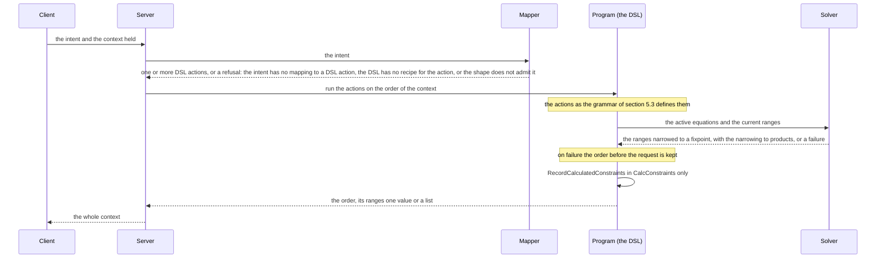

# The variables and equations of an order

This document defines the mathematics of an order after its creation from a medication: the variables, the equations between them, and the operations that change them. The aim is one consistent system in which every order operation can be written, so that:

- use cases can be played out in code as a fixture and a program;
- the code can be tested against stated laws;
- the source can be made simpler, more consistent and easier to read by matching it.

The document defines the target behaviour. The appendix lists where the shipped code differs from it, and the addendum analyses the values that no complete order reaches.

A request passes three layers:

| Layer | What | Document |
|---|---|---|
| **Intent** | what the client sends; the client asks an intent only for an action the variable allows (Table 13b). The server maps the intent to one or more DSL actions (Table 8) and refuses an intent it has no mapping for; it does not check Table 13b itself | section 4.1, Table 8 |
| **Action** | the DSL: `CalcConstraints`, `CalcValues`, `Set v c`, `ReCalc v`, `Reset` | section 5.3, `action` |
| **Effects** | what the program turns an action into; the recipes live here | sections 4.4 and 5.3, `effect`; Tables 13 and 13a |

Terms used throughout:

| Term | Meaning | See |
|---|---|---|
| **orderable** | the thing an order gives, made of components | |
| **component** | a product in the orderable, holding items | |
| **item** | a substance in a component | |
| **preparation** | the made amount of the orderable | |
| **administration** | one dose given from the orderable | |
| **dose type** | one of five: `Once`, a single administration; `Discontinuous`, repeated administrations at a frequency; `Continuous`, one administration running at a rate; `Timed`, repeated administrations each running for a set time; `OnceTimed`, a single administration running for a set time | Table 6 |
| **range** | the set of values a variable may still take, every one of them above zero: a minimum, an increment and a maximum in any combination, including none of them, or a value list, never both | section 5.2 |
| **holds one value**, **solved**, **solved value** | a variable whose range is a list of exactly one value, its solved value. A whole order is solved under the stricter condition of law 10 | law 10 |
| **increment** | the step between the values of a range | |
| **shape** | the form of a range: a list of more than one value; a min, an increment and a max; one value with a defined increment; or any other range. The shape, with the class of the variable, basic or derived, decides which operations are mathematically possible: a list can be selected from; a min, increment and max can be selected from on a basic variable only, since on a derived variable it can hold values no complete order reaches; one value with a defined increment can be stepped on a basic variable only; any other range offers nothing | Table 1b |
| **solve** | narrows every variable by the equations and by the products until nothing changes; it never widens a range | Table 12 |
| **DSL** | the small language in which every action is processed to a list of effects, run by one program, the order processor | section 5.3 |
| **rules** | the dose rule and the solution rule of the medication an order is created from. The dose rule bounds the doses, the frequencies, the administration time and the treatment duration; the solution rule bounds the preparation. Where the text says "the rule", it means the one of these two that bounds the variable in question | |
| **creation** | makes an order from a medication and a patient, turns the rules and the products into the defined constraints; outside the DSL | section 1.3, notes on Table 3, section 5.1 |
| **CalcConstraints** | the first program on the created order: it solves for min and max, and records the calculated constraints | section 5.1 |
| **defined constraints** | the first of the three parts of every variable, written once at creation from the rules and the products | section 5.1 |
| **calculated constraints** | the second part: the solved range CalcConstraints records | section 5.1 |
| **current range** | the third part, the `Value`, which every later operation moves | section 5.1 |
| **divisibility** | the smallest part of one unit of a product that can be given, such as half a tablet or a tenth of a millilitre; creation makes it the defined increment of the component orderable quantity and the orderable dose quantity. Likewise, an administration rate has a "divisibility" due to the physical properties of an administration device, and counts like frequency have a natural increment of one | |
| **set back**, **set-back** | a variable is set back when its current range is replaced by its calculated constraints; a set-back is that operation | |
| **select** | sets a variable to one value of its range | section 4.2 |
| **step** | moves the value of a basic variable by a whole number of its increments, the defined one or the calculated one; only a variable with a defined increment can be stepped, by either increment | section 4.2 |
| **percentile** | sets the orderable dose quantity to a value at a percentage through its range | section 4.2 |
| **recalculation**, **recipe**, **kind**, **keeps** | a recalculation reopens a variable through the recipe of its kind, which names the variables it keeps | sections 4.2 and 4.4 |
| **reset** | sets every variable back | sections 4.2 and 4.4 |
| **choice** | how a `Set` selects its value: min, max, median, nth n, percentile p or step n by an increment | |
| **undetermined** | a variable `y` is undetermined by the kept variables `x1 .. xn` of a recipe *when* the ones among them that hold one value do not determine `y` through the equations. A recalculation sets an undetermined variable back; a step or a percentile frees it; a reset sets every variable back | section 4.4 |
| **freed** | a variable `x` is freed by a step or percentile on a variable `y` when its current range is replaced by any positive value on its defined increment, so that the increment is its smallest value, or by any positive value where it has none, so that `y` can take its new value without `x` blocking it | |
| **complete order** | has one value for every variable, inside its calculated constraints, with every equation holding. A complete order is solved; a solved order need not be complete, since it may leave the adjust quantity open or, after a step, hold a value outside its calculated constraints | |
| **possible** | a value is possible when some complete order holds it | law 19 |

## 1. The variables

### 1.1 Basic variables

A basic variable is set by the user and never derived. The rules bound it by a minimum and maximum, an increment, or a value list. Together with the invariants (section 1.2) the basic variables determine every other variable that has an equation (law 3).

**Table 1. The basic variables.**

| Id | Basic variable | Place in the order | Subsystem | Basic on | Bound by |
|---|---|---|---|---|---|
| `cmp_orb_qty` | component orderable quantity, one per component: the amount of the component in one preparation | `Component.OrderableQuantity` | Compounding | all dose types | the solution rule's min, max and values; the product's divisibility |
| `orb_dos_qty` | orderable dose quantity: the amount of the orderable in one administration | `Orderable.Dose.Quantity` | Dosing | Once, Discontinuous, Timed, OnceTimed | the dose rule's min and max, absolute or adjusted; the product's divisibility as increment |
| `orb_dos_rte` | orderable dose rate: the amount of the orderable per time while it runs | `Orderable.Dose.Rate` | Dosing | Continuous, Timed, OnceTimed | the dose rule's min and max, absolute or adjusted; an increment from the rate unit |
| `ord_sch_frq` | frequency: the number of administrations per time | `Schedule.Frequency` | Scheduling | Discontinuous, Timed | the dose rule's frequencies as a value list, and a defined increment of 1 in their unit, since a frequency is a whole number of administrations; a step moves by that increment and may leave the list |
| `orb_ord_cnt` | order count: the number of times the orderable is prepared | `Orderable.OrderCount` | Ordering | Discontinuous, Continuous, Timed | min 1, increment 1; max from the rule's longest duration |

Notes on Table 1:

- On Continuous the user does not set the orderable dose quantity, and no intent exists for it there (Table 13b): the dose quantity is the whole preparation, the sum of the component orderable quantities, which the user does set (Table 3).
- The increment of the orderable dose quantity is the same as the product's divisibility, set on the dose quantity directly, the same as on the component orderable quantity.
- The defined constraints of a variable can hold a value list and an increment together, where a range holds one or the other: the frequency's hold the rule's frequencies and the increment 1, so a frequency that holds one value is steppable, and a step by 1 may leave the list.
- The order count's min 1 and increment 1 are structural, not from a rule. Its maximum follows from the rule's longest duration through equation 45 or 46. No intent exists for the order count (Table 13b).
- Of the five basic variables with a defined increment, a step is allowed on four: the frequency, the orderable dose quantity, the orderable dose rate and the component orderable quantity; the order count is not stepped (Table 13b).

**Table 1a. The number of basic variables per dose type.** An order with n components has n component orderable quantities, one per component, plus the other basic variables of its dose type, read from the "Basic on" column of Table 1.

| Dose type | `orb_dos_qty` | `orb_dos_rte` | `ord_sch_frq` | `orb_ord_cnt` | Basic variables |
|---|---|---|---|---|---|
| Once | yes | | | | n + 1 |
| Discontinuous | yes | | yes | yes | n + 3 |
| Continuous | | yes | | yes | n + 2 |
| OnceTimed | yes | yes | | | n + 2 |
| Timed | yes | yes | yes | yes | n + 4 |

Before a value is set, the solver narrows each basic variable like any other. How the user can set a value depends on the shape of its range (section 4.2).

**Table 1b. The shapes of a range.**

| Shape | Range | Possible on a basic variable | Possible on a derived variable |
|---|---|---|---|
| selectable list | a list of more than one value | select | select |
| selectable range | a min, an increment and a max | select, without writing out the list | none; the range can hold values no complete order reaches |
| steppable | one value, with a defined increment | step | none |
| not settable | any other range, including a list of one value | none | none |

### 1.2 Invariants

An invariant holds a list of values given from outside the order: by the patient, the product, the dose type or the shape of the order. The solver narrows the list; it never computes a value.

- An invariant's calculated constraints are its given list as restricted in CalcConstraints by the dose limits and the patient.
- An invariant can only be narrowed, or set back to its calculated constraints by a reset, or by a per-time recalculation of a single component whose dose quantity the definition fixes (Table 13).

**Table 2. The invariants.**

| Id | Invariant | Place in the order | Holds | Given by |
|---|---|---|---|---|
| `ord_adj_qty` | adjust quantity: the patient's weight or body surface area | `Order.Adjust` | one value; without the measurement an open range, and every adjusted dose stays a range with it | the patient |
| `cmp_cmp_qty` | component quantity: the content of one product unit, such as one vial or one tablet | `Component.ComponentQuantity` | a list of values, one per product; one value once the product is selected | the product |
| `itm_cmp_cnc` | item component concentration, one per item: the amount of the item in one unit of the component | `Item.ComponentConcentration` | a list of values, one per product; one value once the product is selected | the product |
| `itm_cmp_qty` | item component quantity, one per item: the amount of the item in one product unit | `Item.ComponentQuantity` | a list of values, one per product; one value once the product is selected | the product |
| `orb_dos_cnt` | dose count on Continuous: the number of administrations one preparation gives | `Orderable.DoseCount` | exactly 1: the whole preparation runs as one administration | the dose type |
| `orb_ord_cnt` | order count on Once and OnceTimed: the number of times the orderable is prepared | `Orderable.OrderCount` | exactly 1: the order is one preparation, of which the dose count says how much is given | the dose type |
| `orb_orb_cnc` | orderable share: the orderable's share of itself, which the components' shares add up to | none; the equation mapper makes it, outside the order | exactly 1 | the shape of the order |

Notes on the component invariants, `cmp_cmp_qty`, `itm_cmp_qty` and `itm_cmp_cnc`:

- They are three separate variables, each holding one value per product of the component.
- Equation 1 ties the three together. Since all three are invariants, it narrows them against each other and computes nothing.
- Narrowing one narrows the others only through the narrowing to products after a solve, and only once a single product applies. While more than one product applies, equation 1 combines the values of different products, and the narrowing to products removes the values no product has but not the pairs that belong to different products. So the DSL solves an order once per combination of item concentrations, with the three invariants fixed to that combination, and gives each variable the union of the results (section 5.3 and the appendix).
- With one component, `cmp_orb_cnc` is 1 (equations 25 and 56) and every `itm_orb_cnc` equals its `itm_cmp_cnc` (equations 2, 3 and 56).

### 1.3 Derived variables

A derived variable is calculated from the basic variables and the invariants through the equations of section 3.

**Table 3. The derived variables.**

| Id | Derived variable | Subsystem | Equation | Dose types | Bound at creation by |
|---|---|---|---|---|---|
| `orb_dos_qty` | orderable dose quantity on Continuous: the whole preparation; basic on every other dose type (Table 1) | Dosing | 43 with `orb_dos_cnt` 1 | Continuous | the dose rule's min and max |
| `orb_dos_ptm` | orderable dose per time | Dosing | 51 | Discontinuous, Timed | the dose rule's min and max |
| `cmp_dos_qty` | component dose quantity | Dosing | 31 | all | the component's dose limit, when given |
| `cmp_dos_ptm` | component dose per time | Dosing | 33, 34 | Discontinuous, Timed | the component's dose limit, when given |
| `cmp_dos_rte` | component dose rate | Dosing | 36; on Timed and OnceTimed through 11 | Continuous, Timed, OnceTimed | the component's dose limit, when given |
| `itm_dos_qty` | item dose quantity | Dosing | 4, 5 | all | the substance's dose limit |
| `itm_dos_ptm` | item dose per time | Dosing | 7, 8, 9 | Discontinuous, Timed | the substance's dose limit |
| `itm_dos_rte` | item dose rate | Dosing | 11, 12 | Continuous, Timed, OnceTimed | the substance's dose limit |
| `orb_dos_qty_adj`, `cmp_dos_qty_adj`, `itm_dos_qty_adj` | the dose quantities per adjust unit | Dosing | 50, 32, 6: the quantity ÷ `ord_adj_qty` | all | the adjusted dose limits |
| `orb_dos_ptm_adj`, `cmp_dos_ptm_adj`, `itm_dos_ptm_adj` | the doses per time per adjust unit | Dosing | 52, 35, 10 | Discontinuous, Timed | the adjusted dose limits |
| `orb_dos_rte_adj`, `itm_dos_rte_adj` | the dose rates per adjust unit | Dosing | 53, 13 | Continuous, Timed, OnceTimed | the adjusted dose limits |
| `cmp_dos_rte_adj` | component dose rate per adjust unit | Dosing | 37 | Continuous | the adjusted dose limit, when given |
| `orb_orb_qty` | orderable quantity: the amount of one preparation | Compounding | 56 | all | the rule's quantity min, max and values |
| `orb_dos_cnt` | dose count: administrations per preparation (see note) | Compounding | 43 | all; fixed at 1 on Continuous | the rule's dose count min and max; at least 1 |
| `cmp_orb_cnt` | component orderable count: product units per preparation | Compounding | 27 | all | none |
| `cmp_orb_cnc` | component orderable concentration: the component's share of the preparation | Compounding | 25 | all | max 1; exactly 1 with one component |
| `itm_orb_qty` | item orderable quantity: the item in one preparation | Compounding | 3 | all | the solution rule's min and max |
| `itm_orb_cnc` | item orderable concentration | Compounding | 2; 57 where 2 is dropped | all | the solution rule's max concentration |
| `ord_sch_tme` | administration time: how long one administration runs | Scheduling | 49 | Continuous, Timed, OnceTimed | the rule's time min and max |
| `ord_sch_cnt` | schedule count: the fraction of the dosing interval the administration runs, time × frequency | Scheduling | 60 | Timed | max 1 |
| `ord_ord_tme` | treatment duration: the span the prepared amount covers at the schedule (see note) | Ordering | 45 or 46 with 44 | Discontinuous, Continuous, Timed | the rule's duration min and max |
| `orb_ord_qty` | orderable order quantity: the amount prepared over the order | Ordering | 44 | all; the count is 1 on Once and OnceTimed | none |
| `cmp_ord_qty` | component order quantity | Ordering | 59 | all | none |
| `cmp_ord_cnt` | component order count: product units for the whole order | Ordering | 28 | all | none |
| `orb_dos_tot`, `cmp_dos_tot`, `itm_dos_tot` | the dose totals: the amount prepared over the order, an upper bound of the amount administered | Ordering | 47, 29, 14 or 48, 30, 15 | Discontinuous, Continuous, Timed | none |
| `itm_dos_tot_adj` | item dose total per adjust unit | Ordering | 23, 24 | Discontinuous, Continuous, Timed | none |

Notes on Table 3:

- A variable can be basic on one dose type and derived on another. The orderable dose quantity `orb_dos_qty` is basic where the user sets it, on Once, Discontinuous, Timed and OnceTimed, and derived on Continuous, where it is the preparation. The order count `orb_ord_cnt` is basic on Discontinuous, Continuous and Timed and the invariant 1 on Once and OnceTimed (Table 2).
- The dose count `orb_dos_cnt` is at least 1 and not necessarily whole, so the dose quantity is at most the orderable quantity. Its defined constraints are what the rules give, as they give them; when the rules give none, creation sets it to 1. A dose step or a component quantity step moves the dose count.
- The treatment duration `ord_ord_tme` counts a partial last preparation as given, so it can exceed the real treatment by less than one preparation. The rule's duration bounds are pushed back into the order count.
- Every variable an equation holds is in Table 1, Table 2 or Table 3. Three variables an order could have are left out because no equation holds them, as they have no clinical relevance: the orderable dose total per adjust unit `orb_dos_tot_adj`, the component dose total per adjust unit `cmp_dos_tot_adj`, and, on Timed and OnceTimed, the component dose rate per adjust unit `cmp_dos_rte_adj`.
- Turning the rules into defined constraints is creation, outside the DSL. The last column says what creation bounds, so that the containment law (law 1) has its reference.

## 2. The subsystems

### 2.1 The subsystems

A subsystem is the part of the order's equations around one clinical decision: its basic variable, if it has one, and the derived variables of the same row in Table 4.

- A recalculation sets back what its kept variables do not determine, which can span more than one subsystem. The solve that follows narrows the whole order.
- A hinge (Table 5) is a ratio whose equation reaches outside its own subsystem, and so couples two subsystems.
- A subsystem without a basic variable on a dose type (Scheduling on Once, Continuous and OnceTimed; Ordering on Once and OnceTimed) is set back by every recalculation whose kept variables do not determine it. Its variables then follow from the hinge equations in the solve.

**Table 4. The subsystems.**

| Subsystem | Basic (Table 1) | Invariant (Table 2) | Derived (Table 3) |
|---|---|---|---|
| Dosing | `orb_dos_qty`, `orb_dos_rte` | `ord_adj_qty` | `orb_dos_ptm`; `cmp_dos_qty`, `cmp_dos_ptm`, `cmp_dos_rte`; `itm_dos_qty`, `itm_dos_ptm`, `itm_dos_rte`; the `_adj` form of each |
| Compounding | `cmp_orb_qty`, one per component | `cmp_cmp_qty`, `itm_cmp_qty`, `itm_cmp_cnc`, `orb_orb_cnc` | `orb_orb_qty`, `orb_dos_cnt`; `cmp_orb_cnt`, `cmp_orb_cnc`; `itm_orb_qty`, `itm_orb_cnc` |
| Scheduling | `ord_sch_frq` | none | `ord_sch_tme`, `ord_sch_cnt` |
| Ordering | `orb_ord_cnt` | none | `ord_ord_tme`; `orb_ord_qty`, `cmp_ord_qty`, `cmp_ord_cnt`; `orb_dos_tot`, `cmp_dos_tot`, `itm_dos_tot`, `itm_dos_tot_adj` |

A variable's class can depend on the dose type; Tables 1 to 3 give the dose types for each variable.

### 2.2 The hinges

Every multiplication equation except 57 and 60 relates two amounts through one ratio:

- the amounts are quantities, per times, rates and totals;
- the ratio is a count, a concentration, the frequency, the time or the duration;
- 57 and 60 relate ratios only.

A hinge is a ratio whose equation reaches outside its own subsystem: its two amounts lie in different subsystems, or the ratio lies outside the amounts' subsystem. Amounts are never hinges.

**Table 5. The hinges.**

| Hinge | Subsystem | Stands in equations of | Equations of section 3 |
|---|---|---|---|
| `orb_dos_cnt` | Compounding | Dosing | 43: `orb_orb_qty = orb_dos_cnt * orb_dos_qty`; 26: the same per component |
| `cmp_orb_cnc`, `itm_orb_cnc`, `itm_cmp_cnc` | Compounding | Dosing, across the levels | component dose = `cmp_orb_cnc` × orderable dose: 31, 33, 36, 38, 40, 42; item dose = `itm_orb_cnc` × orderable dose: 5, 8, 12, 17, 19, 22; item dose = `itm_cmp_cnc` × component dose: 4, 7, 11, 16, 18, 21 |
| `ord_sch_frq` | Scheduling | Dosing | per time = quantity × frequency: 51, 34, 9, 55, 41, 20 |
| `ord_sch_tme` | Scheduling | Dosing | quantity = rate × time: 49, 54, 39 |
| `ord_ord_tme` | Ordering | Dosing | total = per time × duration: 47, 29, 14, 23; total = rate × duration: 48, 30, 15, 24; order quantity = per time or rate × duration: 45, 46 |
| `orb_ord_cnt`, `cmp_ord_cnt` | Ordering | Compounding | 44: `orb_ord_qty = orb_ord_cnt * orb_orb_qty`; 59: `cmp_ord_qty = cmp_orb_qty * orb_ord_cnt`; 28: `cmp_ord_qty = cmp_cmp_qty * cmp_ord_cnt` |

Ratios that are not hinges:

- `ord_adj_qty`: both amounts lie in Dosing;
- `cmp_orb_cnt`: both amounts lie in Compounding;
- the ratios of 57 and 60: these equations have no amount.

### 2.3 The subsystems per dose type

**Table 6. The subsystems per dose type.**

| Dose type | Dosing | Compounding | Scheduling | Ordering |
|---|---|---|---|---|
| Once | the quantities: 31, 4, 5 and their adjust forms 50, 32, 6, 38, 16, 17 | the whole subsystem: 56, 25, 27, 1, 2, 3; 57 and 58 with more than one component | none | `orb_ord_qty`, `cmp_ord_qty`, `cmp_ord_cnt`: 44, 59, 28, with `orb_ord_cnt` 1; no totals, no duration |
| Discontinuous | the quantities and the per times: 51, 34, 9, 33, 7, 8 and adjust forms 52, 35, 10, 55, 41, 20, 40, 18, 19 | the whole subsystem | `ord_sch_frq` | order quantities and counts; totals 47, 29, 14, 23; duration 45 |
| Continuous | the rates: 36, 12, 11 and adjust forms 53, 37, 13, 42, 21, 22; the quantity is the preparation, 43 with `orb_dos_cnt` 1 | the whole subsystem | `ord_sch_tme`: 49, 54, 39 | order quantities and counts; totals 48, 30, 15, 24; duration 46 |
| OnceTimed | the quantities; the rates `orb_dos_rte`, `itm_dos_rte` and `cmp_dos_rte` through 11: 53, 12, 11, 13 | the whole subsystem | `ord_sch_tme`: 49 | order quantities and counts, with `orb_ord_cnt` 1; no totals, no duration |
| Timed | the quantities and per times; the rates `orb_dos_rte`, `itm_dos_rte` and `cmp_dos_rte` through 11: 53, 12, 11, 13 | the whole subsystem | `ord_sch_frq`, `ord_sch_tme`, `ord_sch_cnt`: 49, 60 | order quantities and counts; totals 47, 29, 14, 23; duration 45 |

## 3. The equations

The equations are numbered for reference. Each holds for every component and every item the order has.

How to read Table 7:

- A cross marks the dose types where the equation is active.
- The last column holds the condition the shipped mapping applies on top of the dose type. "cmps" is the number of components; "itms one strength" means every item comes in exactly one strength.
- The condition restricts the crossed dose types, except in row 36, where it adds Timed and OnceTimed under that condition.

Equations that need comment:

- **The tie, 45 and 46.** Orderable order quantity = per time × duration on Discontinuous and Timed, and = rate × duration on Continuous, like the totals. They couple Ordering to the other subsystems. With 47 and 48 they give `orb_ord_qty = orb_dos_tot`: prepared amount = total. Read in the count's direction: the order count is given, the duration follows.
- **The concentration ties, 57 and 58.** Both are for a multi-component order.
  - 2, 3 and 25 imply 57 for any number of components, so 57 adds nothing where 2 is active. It is needed with more than two components of one strength, where the condition drops 2.
  - 25 and 56 imply 58, whose head `orb_orb_cnc` is the constant 1 of Table 2. It stays because the fixed head bounds each component's share directly, as 1 minus the others' minimums, which 25 and 56 reach only through the orderable quantity's range.
- **Component ordering, 59.** With 28 it gives the component order count, the product units for the whole order.
- **The schedule count, 60.** The one inequality that needs its own variable: an administration ends before the next starts, `sch_tme ≤ 1 ÷ sch_frq`.
  - The solver has no inequality, but it has a range with a maximum only, and in a multiplication equation a factor receives the result's maximum divided by the other factor's minimum.
  - So `sch_cnt`, a count with max 1, gives `sch_tme ≤ 1 ÷ min sch_frq` and `sch_frq ≤ 1 ÷ min sch_tme`, and nothing else.
  - Units: time × count per time = count.
  - By 49 and 51, `sch_cnt = orb_dos_ptm ÷ orb_dos_rte`, so the same bound reads per time ≤ rate.

**Table 7. The equations, with the dose types where each is active and the condition of the shipped mapping.**

| # | Equation | Discontinuous | Continuous | Timed | Once | OnceTimed | Condition |
|---|---|---|---|---|---|---|---|
| 1 | `[itm]_cmp_qty = [itm]_cmp_cnc * [cmp]_cmp_qty` | x | x | x | x | x |  |
| 2 | `[itm]_orb_qty = [itm]_orb_cnc * [orb]_orb_qty` | x | x | x | x | x | not when cmps > 2 and itms one strength |
| 3 | `[itm]_orb_qty = [itm]_cmp_cnc * [cmp]_orb_qty` | x | x | x | x | x |  |
| 4 | `[itm]_dos_qty = [itm]_cmp_cnc * [cmp]_dos_qty` | x | x | x | x | x |  |
| 5 | `[itm]_dos_qty = [itm]_orb_cnc * [orb]_dos_qty` | x | x | x | x | x | not when cmps > 2 and itms one strength |
| 6 | `[itm]_dos_qty = [itm]_dos_qty_adj * [ord]_adj_qty` | x | x | x | x | x |  |
| 7 | `[itm]_dos_ptm = [itm]_cmp_cnc * [cmp]_dos_ptm` | x |  | x |  |  |  |
| 8 | `[itm]_dos_ptm = [itm]_orb_cnc * [orb]_dos_ptm` | x |  | x |  |  | not when cmps > 2 and itms one strength |
| 9 | `[itm]_dos_ptm = [itm]_dos_qty * [ord]_sch_frq` | x |  | x |  |  |  |
| 10 | `[itm]_dos_ptm = [itm]_dos_ptm_adj * [ord]_adj_qty` | x |  | x |  |  |  |
| 11 | `[itm]_dos_rte = [itm]_cmp_cnc * [cmp]_dos_rte` |  | x | x |  | x |  |
| 12 | `[itm]_dos_rte = [itm]_orb_cnc * [orb]_dos_rte` |  | x | x |  | x | not when cmps > 2 and itms one strength |
| 13 | `[itm]_dos_rte = [itm]_dos_rte_adj * [ord]_adj_qty` |  | x | x |  | x |  |
| 14 | `[itm]_dos_tot = [itm]_dos_ptm * [ord]_ord_tme` | x |  | x |  |  |  |
| 15 | `[itm]_dos_tot = [itm]_dos_rte * [ord]_ord_tme` |  | x |  |  |  |  |
| 16 | `[itm]_dos_qty_adj = [itm]_cmp_cnc * [cmp]_dos_qty_adj` | x | x | x | x | x |  |
| 17 | `[itm]_dos_qty_adj = [itm]_orb_cnc * [orb]_dos_qty_adj` | x | x | x | x | x | not when cmps > 2 and itms one strength |
| 18 | `[itm]_dos_ptm_adj = [itm]_cmp_cnc * [cmp]_dos_ptm_adj` | x |  | x |  |  |  |
| 19 | `[itm]_dos_ptm_adj = [itm]_orb_cnc * [orb]_dos_ptm_adj` | x |  | x |  |  | not when cmps > 2 and itms one strength |
| 20 | `[itm]_dos_ptm_adj = [itm]_dos_qty_adj * [ord]_sch_frq` | x |  | x |  |  |  |
| 21 | `[itm]_dos_rte_adj = [itm]_cmp_cnc * [cmp]_dos_rte_adj` |  | x |  |  |  |  |
| 22 | `[itm]_dos_rte_adj = [itm]_orb_cnc * [orb]_dos_rte_adj` |  | x |  |  |  | not when cmps > 2 and itms one strength |
| 23 | `[itm]_dos_tot_adj = [itm]_dos_ptm_adj * [ord]_ord_tme` | x |  | x |  |  |  |
| 24 | `[itm]_dos_tot_adj = [itm]_dos_rte_adj * [ord]_ord_tme` |  | x |  |  |  |  |
| 25 | `[cmp]_orb_qty = [cmp]_orb_cnc * [orb]_orb_qty` | x | x | x | x | x |  |
| 26 | `[cmp]_orb_qty = [orb]_dos_cnt * [cmp]_dos_qty` | x | x | x | x | x |  |
| 27 | `[cmp]_orb_qty = [cmp]_cmp_qty * [cmp]_orb_cnt` | x | x | x | x | x |  |
| 28 | `[cmp]_ord_qty = [cmp]_cmp_qty * [cmp]_ord_cnt` | x | x | x | x | x |  |
| 29 | `[cmp]_dos_tot = [cmp]_dos_ptm * [ord]_ord_tme` | x |  | x |  |  |  |
| 30 | `[cmp]_dos_tot = [cmp]_dos_rte * [ord]_ord_tme` |  | x |  |  |  |  |
| 31 | `[cmp]_dos_qty = [cmp]_orb_cnc * [orb]_dos_qty` | x | x | x | x | x |  |
| 32 | `[cmp]_dos_qty = [cmp]_dos_qty_adj * [ord]_adj_qty` | x | x | x | x | x |  |
| 33 | `[cmp]_dos_ptm = [cmp]_orb_cnc * [orb]_dos_ptm` | x |  | x |  |  |  |
| 34 | `[cmp]_dos_ptm = [cmp]_dos_qty * [ord]_sch_frq` | x |  | x |  |  |  |
| 35 | `[cmp]_dos_ptm = [cmp]_dos_ptm_adj * [ord]_adj_qty` | x |  | x |  |  |  |
| 36 | `[cmp]_dos_rte = [cmp]_orb_cnc * [orb]_dos_rte` |  | x |  |  |  | also Timed, OnceTimed when cmps > 2 and itms one strength |
| 37 | `[cmp]_dos_rte = [cmp]_dos_rte_adj * [ord]_adj_qty` |  | x |  |  |  |  |
| 38 | `[cmp]_dos_qty_adj = [cmp]_orb_cnc * [orb]_dos_qty_adj` | x | x | x | x | x |  |
| 39 | `[cmp]_dos_qty_adj = [cmp]_dos_rte_adj * [ord]_sch_tme` |  | x |  |  |  |  |
| 40 | `[cmp]_dos_ptm_adj = [cmp]_orb_cnc * [orb]_dos_ptm_adj` | x |  | x |  |  |  |
| 41 | `[cmp]_dos_ptm_adj = [cmp]_dos_qty_adj * [ord]_sch_frq` | x |  | x |  |  |  |
| 42 | `[cmp]_dos_rte_adj = [cmp]_orb_cnc * [orb]_dos_rte_adj` |  | x |  |  |  |  |
| 43 | `[orb]_orb_qty = [orb]_dos_cnt * [orb]_dos_qty` | x | x | x | x | x |  |
| 44 | `[orb]_ord_qty = [orb]_ord_cnt * [orb]_orb_qty` | x | x | x | x | x |  |
| 45 | `[orb]_ord_qty = [orb]_dos_ptm * [ord]_ord_tme` | x |  | x |  |  |  |
| 46 | `[orb]_ord_qty = [orb]_dos_rte * [ord]_ord_tme` |  | x |  |  |  |  |
| 47 | `[orb]_dos_tot = [orb]_dos_ptm * [ord]_ord_tme` | x |  | x |  |  |  |
| 48 | `[orb]_dos_tot = [orb]_dos_rte * [ord]_ord_tme` |  | x |  |  |  |  |
| 49 | `[orb]_dos_qty = [orb]_dos_rte * [ord]_sch_tme` |  | x | x |  | x |  |
| 50 | `[orb]_dos_qty = [orb]_dos_qty_adj * [ord]_adj_qty` | x | x | x | x | x |  |
| 51 | `[orb]_dos_ptm = [orb]_dos_qty * [ord]_sch_frq` | x |  | x |  |  |  |
| 52 | `[orb]_dos_ptm = [orb]_dos_ptm_adj * [ord]_adj_qty` | x |  | x |  |  |  |
| 53 | `[orb]_dos_rte = [orb]_dos_rte_adj * [ord]_adj_qty` |  | x | x |  | x |  |
| 54 | `[orb]_dos_qty_adj = [orb]_dos_rte_adj * [ord]_sch_tme` |  | x |  |  |  |  |
| 55 | `[orb]_dos_ptm_adj = [orb]_dos_qty_adj * [ord]_sch_frq` | x |  | x |  |  |  |
| 56 | `[orb]_orb_qty = sum([cmp]_orb_qty)` | x | x | x | x | x |  |
| 57 | `[itm]_orb_cnc = [itm]_cmp_cnc * [cmp]_orb_cnc` | x | x | x | x | x | cmps > 1 |
| 58 | `[orb]_orb_cnc = sum([cmp]_orb_cnc)` | x | x | x | x | x | cmps > 1 |
| 59 | `[cmp]_ord_qty = [cmp]_orb_qty * [orb]_ord_cnt` | x | x | x | x | x |  |
| 60 | `[ord]_sch_cnt = [ord]_sch_tme * [ord]_sch_frq` |  |  | x |  |  |  |

## 4. The operations on an order variable

Each operation is a function on the state of section 5. This section describes the operations of the DSL; where today's code differs, Table 15 says so.

Every operation is one of three things:

- an intersection of a current range with a constraint;
- a set-back to the calculated constraints;
- in a recalculation, the solved value a variable had in the original order included in its new list.

The solve never widens a range (today's fallback past five hundred values is in Table 15). Only solve moves a value from one variable to another.

### 4.1 The requests

The DSL starts at what the client sends. A request is:

- the session token;
- the intent;
- the context as the client holds it: the patient, the filter and the scenario with its order.

Nothing else travels. The server runs the program on the scenario's order and returns the whole context. The client does not query: the range each variable holds in the order, with the intents defined for it (section 4.5, Table 13b), decides what the client can do with it (section 4.2).

The DSL has one `Set` action, with a variable and a choice, and one `ReCalc` action, with a variable. The intents replace the shipped wire commands, and with them the two command types of GenORDER the wire commands are translated to today, `OrderCommand` and `ChangePropertyCommand`; Table 8 records each shipped wire command and the DSL action it becomes.

**Table 8. The shipped wire commands and the DSL action each becomes.**

| Shipped wire command | DSL action |
|---|---|
| Increase, Decrease, SetMin, SetMax, SetMedian, SetNth of a property, a component quantity or an item component concentration; SetOrderableDoseQuantityPerc | `Set v c`, with the choice the name says |
| none today; `ComponentInStock` is a case of the shipped `ChangePropertyCommand` that no wire command reaches and the processor does not implement | `NarrowProducts` |
| Clear of a property, to be renamed ReCalc; the list of selected names it carries today goes, only the variable name to be recalculated remains | `ReCalc v`; refused for a variable that no kind recalculates (Table 13) |
| ResetOrderScenario | `Reset` |
| UpdatePatient; SetNthFilter, ClearFilter, ClearAllFilter; SetNthDiluent, ClearDiluent; SetNthComponents; SelectNthOrderScenario | the context is evaluated again and its orders created from the medication and the patient: creation, outside the DSL, then CalcConstraints |
| SetArgumentation | text on the context; outside the DSL |

The state of section 5 is the contract's context, with the order inside. The client holds it between requests and sends it back, so a request on the state the client returns equals the request on the state the server last sent.

One request, from the wire to the solver and back:



### 4.2 The user actions

Every `Set` brings its target to one value and solves in MinMax mode; after an nth it also makes the value lists. A select and a step constrain the target to the value `x`; a percentile selects its value after its recipe and a solve (section 5.3).

- A select runs no recipe and sets nothing back.
- A step runs the step recipe of its target (Table 13a). It is a deliberate act to go past the limits, so the target and the variables its recipe frees may cross their calculated and their defined constraints.
- A percentile runs the percentile recipe of the orderable dose quantity (Table 13a), on an order whose composition the user set.
- The client sends the order and the intent; the server reads nothing else and keeps nothing.

Three things decide what can be done with a variable (Table 8a). The operations on a variable are coded once: select the min, max, median or nth value, step by an increment, set back to constraints, solve. An action is refused when the shape of the range does not admit it (Table 9).

**Table 8a. What decides what can be done with a variable.**

| Layer | Decides | Content | Encoded by | Where |
|---|---|---|---|---|
| **Mathematics** | whether an operation is possible | the shape of the range (Table 1b): a list of more than one value, or a min, increment and max on a basic variable, can be selected from; one value of a basic variable with a defined increment can be stepped; a step is not bounded by the constraints because the operation is not | actions and choices | Tables 1b and 9 |
| **Recipe** | how an action is done | what is kept, what is set back and to what, and what is selected | recipes | section 4.4, Tables 13 and 13a |
| **Business rule** | whether a possible action is allowed on the variable | a step only on the frequency, the orderable dose quantity, the orderable dose rate and a component orderable quantity; a percentile only on the orderable dose quantity; a recalculation only where Table 13b gives one. Stepping the order count is possible but not allowed | intent, asked by the client | section 4.5, Table 13b |

A select runs no recipe and sets nothing back, so the DSL can run it on any variable whose shape admits it. A step, a percentile and a recalculation run only where the DSL has a recipe for them, and those recipes exist only where Table 13b allows the action. The intents are therefore the business rule: an action without an intent is never sent to the DSL, but the DSL could run it.

Nth, min, median, max and a step read the shape of the range the variable holds (Table 1b). A percentile does not: its recipe first sets the orderable dose quantity back, and it counts along the range after the recipe and its solve (Table 10).

**Table 9. What `Set` can do with a variable, by the shape of the range it holds.**

| Range | Shape (Table 1b) | `Set` | Select (nth, min, median, max) | Step |
|---|---|---|---|---|
| a value list `[x1; x2; ..]` of more than one value | selectable list | select: the min, median, max or nth value of the list | yes | no |
| `<min..incr..max>` of a basic variable | selectable range | select: the min, median, max or nth value that the min, increment and max hold, without writing out the list | yes | no |
| `<min..incr..max>` of a derived variable | not settable | none; the range can hold values no complete order reaches, so only the solver narrows it | no | no |
| one value of a basic variable, with an increment in its defined constraints | steppable | step: n increments up or down, of the defined increment or of the calculated one | no | yes |
| one value without a defined increment, a one value list, or a derived variable's one value | not settable | none | no | no |
| `<min..max>`, or any range open at one or both ends, with or without an increment | not settable | none; only the solver narrows it | no | no |

**Table 10. The value each choice of `Set` selects.**

| Choice | The value chosen |
|---|---|
| select: min, max | the minimum or maximum of the range the variable holds |
| select: median | the middle value of the list; for an even number of values the higher of the two middle values |
| select: nth | the nth value of the list; on a component invariant a value of one of the component's products |
| percentile | the value at that percentage of the way from the min to the max of the range after the recipe and its solve, on its increment: with count the number of values from the min to the max, the value at index (count − 1) × percentage ÷ 100 in whole numbers, counted from 0 at the min; so 0 gives the min and 100 the max |
| step | the solved value ± n increments of the defined increment, or of the calculated one when the choice asks for it; never below one increment; it may cross the calculated and the defined constraints. Only a basic variable is steppable; a step by the calculated increment is allowed only where a defined one exists |

Three actions have their own form.

**Table 11. The actions with their own form.**

| Action | What it does |
|---|---|
| narrow the products | the component's product set → the products in stock, so the three component invariants shrink |
| recalculate | runs the recipe of the target's kind, without a constraint: the recipe names what it keeps, every variable the kept variables do not determine is set back to its calculated constraints, then solve (Table 13) |
| reset | every variable → its calculated constraints |

### 4.3 The processor operations

**Table 12. The processor operations.**

| Operation | Range before → after |
|---|---|
| constrain | current range → current range ∩ a bound: a min, max, increment or value list; never the defined constraints, which creation writes |
| record | the solved range → stored as the variable's calculated constraints, which the user actions, the recipes and reset read; runs once, in CalcConstraints |
| coarsen | the increment → a multiple of it, by a rule (see note) |
| enumerate | min, increment, max → the list of the values they hold, pruned to round steps |
| narrow to products | the component's product set → the products whose content and concentrations still fit the current ranges, and those ranges → the values of the remaining products; part of solve |
| solve | every equation narrows each of its variables by the others, and narrowing to products narrows the component invariants, repeated until neither changes anything; min and max only, or with values; the only operation on more than one variable; it never widens a range |

The coarsen rule:

- it acts on the orderable quantity first, then on the dose quantity;
- only when the orderable is a volume, and never on Continuous;
- until at most a hundred values in the recalculation path and ten in CalcConstraints;
- each coarser increment is followed by a solve for min and max; when that solve fails, the increment stays as it was, so a further solve for min and max after coarsening changes nothing.

Four conditions serve the control flow:

- the dose is solved;
- the order is solved;
- the order has its value lists;
- the normal dose can be set.

Effects compose in sequence with a solve between them; section 5.3 gives each action as its effects.

### 4.4 The recipes

A recalculation names a variable that Table 13 lists for a kind: the basic variable the kind recalculates, or one of the derived variables listed with it. The kind names the basic variables it recalculates.

What a recipe states:

- only what the recalculation keeps: a choice among the basic variables and the invariants, with the condition under which each is kept;
- a recipe keeps a variable it names only when that variable lies within its calculated constraints; a variable a step moved outside them is set back with the rest;
- every variable undetermined by the kept variables is set back to its calculated constraints, and the solve that follows narrows it again.

When a variable is undetermined:

- a variable is undetermined when the kept variables that hold one value do not determine it;
- they determine a variable that follows from them through the equations: the product equations together, by elimination over the logarithms of their variables, and a sum equation when all its variables but one are determined; this repeats until nothing more follows;
- elimination fixes everything a chain of single equations fixes, and also a variable that only several product equations fix together;
- the orderable share, the constant 1 the equations add, counts as known;
- a sum of one term is the identity of its two variables, a product equation for the elimination.

Consequences:

- the recalculated basics are never kept, so they are always set back, and a recalculation whose kept variables still fix its target breaks law 16;
- Ordering's derived variables, the duration, the order quantities and the totals, are undetermined under every recipe unless the kept variables fix them;
- there is no Dose kind on Continuous: the dose quantity is the preparation there and has no recalculation, for the reasons a component quantity has none (below); the dose on a continuous order is its rate, which the Time kind recalculates.

**Table 13. The recipes, by kind: what each recalculation keeps.**

| Kind | Recalculates | Named by | Kept | By dose type |
|---|---|---|---|---|
| Dose | `orb_dos_qty` | `orb_dos_qty`, `itm_dos_qty` and `itm_dos_qty_adj` on Once, Discontinuous, Timed and OnceTimed | `ord_sch_frq`; `orb_ord_cnt`; the invariants. The preparation is never kept: through 43 a kept preparation limits the dose to the preparation divided by the dose count, a single value when the dose count holds one value | on Timed and OnceTimed `ord_sch_tme` and the rates are undetermined with the dose |
| Per time | `orb_dos_qty` and `ord_sch_frq` | `itm_dos_ptm` and `itm_dos_ptm_adj` on Discontinuous and Timed | as Dose, without `ord_sch_frq`; with one component whose dose quantity the definition fixes (its calculated constraints hold one value) also without the component's product: `cmp_cmp_qty`, every `itm_cmp_cnc` and `itm_cmp_qty` | Discontinuous and Timed |
| Time | `orb_dos_rte` | `orb_dos_rte`, `ord_sch_tme`, `itm_dos_rte` and `itm_dos_rte_adj` on Continuous, Timed and OnceTimed | `ord_sch_frq`; `orb_ord_cnt`; the invariants; `orb_dos_qty` where it is basic, unless the time is fixed (its calculated constraints hold one value) or the preparation lies outside its constraints; every `cmp_orb_qty` unless the preparation lies outside its constraints or the time is fixed | Continuous, Timed, OnceTimed |

Variables without a recalculation; a recalculation of any of these is refused:

- A component quantity. For a component with dosed items, the item doses and the product determine its quantity when the dose count holds one value, so a recalculation would offer only the value the order holds. For a component without dosed items, such as a diluent, a different quantity changes the preparation volume, and no kind decides what moves with it: the dose, the dose count or the rate. The preparation changes through a select, a step or a reset.
- A component invariant. The product is chosen in the filter or by a select.
- The variables of Ordering. They follow from the dose and the order count, and no recipe determines them.
- Any other variable that Table 13 does not list: no recalculation intent exists for it (Table 13b).

A step does not use the recipes by kind: each steppable basic has a step recipe of its own (Table 13a).

- A step recipe states what it keeps, as a recalculation does.
- It frees every variable undetermined by the kept variables to any positive value, except its target, which the step gives its value; then it sets the floors it names.
- The target is not kept, since its value changes, so everything that follows from the target is freed with it.
- The percentile keeps no target either; it sets the orderable dose quantity to a floor of its own.

**Table 13a. The step and percentile recipes: what each keeps, and the floors it sets after the free.**

| Target | Kept | Set to a floor after the free | Notes |
|---|---|---|---|
| `ord_sch_frq` | `orb_dos_qty`; every `cmp_orb_qty`; `orb_dos_rte` on a dose type with a time; `orb_ord_cnt`; the invariants | none | the per times follow the frequency |
| `orb_dos_qty` | `ord_sch_frq`; `orb_dos_rte` on a dose type with a time; `orb_ord_cnt`; the invariants; with more components every `cmp_orb_qty` | `orb_dos_cnt` to 1 with one component, to at least 1 with more | on a dose type with a time `ord_sch_tme` follows the dose |
| `orb_dos_rte` | `ord_sch_frq`; `orb_dos_qty`; every `cmp_orb_qty`; `orb_ord_cnt`; the invariants | none | on a dose type with a time `ord_sch_tme` follows the rate |
| that `cmp_orb_qty` | `ord_sch_frq`; the other components' `cmp_orb_qty`; `orb_dos_rte` on a dose type with a time; `orb_ord_cnt`; the invariants; with one component `orb_dos_qty` | `orb_orb_qty` to its min and increment; with more components `orb_dos_cnt` to 1 and `orb_dos_qty` to its min and increment | |
| `orb_dos_qty`, percentile | `ord_sch_frq`; every `cmp_orb_qty`; `orb_ord_cnt`; the invariants | `orb_dos_qty` to its defined constraints up to the orderable quantity; `orb_dos_qty_adj` and `orb_dos_rte` to their defined constraints; `orb_dos_cnt` to at least 1; on a dose type with a time `ord_sch_tme` to its calculated constraints | only on a composed order |

Selecting a value of a derived variable constrains it to that value, and the solve pushes it into the basic variables it depends on, possibly in more than one subsystem: selecting a per time narrows the dose quantity and the frequency. A derived variable that Table 13 lists is recalculated by its kind; what offers the values of any derived variable again is law 4.

### 4.5 What the user can do with each variable

Table 13b shows which variable allows which action (section 4.2), per variable: its class, whether it takes a select, a step or a percentile, and which kind recalculates it. The table states what is allowed; what one order allows at one moment also depends on the shape of the range (Table 9). A reset moves every variable and has no column. What a step or a recalculation moves along with its target is in Tables 13 and 13a.

The values of the cells:

- "yes" under select means whenever the variable holds a list of more than one value, or a min, increment and max on a basic variable (Table 1b);
- "no" means not allowed for this variable, or the shape of its range gives nothing to select (Table 9);
- "planned" marks the Preparation kind, which the implementation plan adds and the script does not hold yet.

**Table 13b. What the user can do with each variable.** O = Once, D = Discontinuous, C = Continuous, T = Timed, OT = OnceTimed.

| Id | Class | Dose types | Select (nth, min, median, max) | Step | Percentile | Recalculation | Notes |
|---|---|---|---|---|---|---|---|
| `ord_sch_frq` | basic | D, T | yes | yes, by 1 | no | none, refused | |
| `orb_dos_qty` | basic; derived on C | all | yes; on C no | yes; on C no | yes, on a composed order; on C no | Dose; on C none | on C it is the preparation |
| `orb_dos_rte` | basic | C, T, OT | yes | yes | no | Time | |
| `cmp_orb_qty` | basic | all | yes | yes | no | none today, refused; Preparation planned | |
| `orb_ord_cnt` | basic; invariant 1 on O, OT | all | no | no | no | none | min 1, increment 1; the user never sets it |
| `ord_adj_qty` | invariant | all | no | no | no | none | the patient |
| `cmp_cmp_qty` | invariant | all | nth only, selects a product (business rule); no intent today | no | no | none | the product; follows a select of `itm_cmp_cnc` or `itm_cmp_qty` and the products in stock |
| `itm_cmp_qty` | invariant | all | nth only, selects a product (business rule); no intent today | no | no | none | the product; follows as `cmp_cmp_qty` |
| `itm_cmp_cnc` | invariant | all | nth only, selects a product (business rule) | no | no | none, refused | the product |
| `orb_dos_cnt` | derived; invariant 1 on C | all | no | no | no | none | set to a floor by a dose step (Table 13a); the user never sets it |
| `ord_sch_tme` | derived | C, T, OT | yes | no | no | Time | |
| `ord_sch_cnt` | derived | T | no | no | no | none | equation 60 not shipped |
| `orb_orb_qty` | derived | all | yes | no | no | none today, refused; Preparation planned | |
| `cmp_orb_cnt` | derived | all | yes | no | no | none | |
| `cmp_orb_cnc` | derived | all | yes | no | no | none | 1 with one component |
| `itm_orb_qty` | derived | all | yes | no | no | none today, refused; Preparation planned | |
| `itm_orb_cnc` | derived | all | yes | no | no | none today, refused; Preparation planned, not with one component | |
| `orb_dos_qty_adj` | derived | all | yes | no | no | none | set to its defined constraints by the percentile; follows `orb_dos_qty` through equation 50 |
| `orb_dos_ptm`, `orb_dos_ptm_adj` | derived | D, T | yes | no | no | none | |
| `orb_dos_rte_adj` | derived | C, T, OT | yes | no | no | none | |
| `cmp_dos_qty` | derived | all | yes | no | no | none | |
| `cmp_dos_qty_adj` | derived | all | yes | no | no | none today, refused; Preparation planned | |
| `cmp_dos_ptm`, `cmp_dos_ptm_adj` | derived | D, T | yes | no | no | none | |
| `cmp_dos_rte` | derived | C, T, OT | yes | no | no | none | |
| `cmp_dos_rte_adj` | derived | C | yes | no | no | none | |
| `itm_dos_qty`, `itm_dos_qty_adj` | derived | all | yes | no | no | Dose on O, D, T, OT; on C none | |
| `itm_dos_ptm`, `itm_dos_ptm_adj` | derived | D, T | yes | no | no | Per time | |
| `itm_dos_rte`, `itm_dos_rte_adj` | derived | C, T, OT | yes | no | no | Time | |
| `ord_ord_tme`; `orb_ord_qty`, `cmp_ord_qty`, `cmp_ord_cnt`; `orb_dos_tot`, `cmp_dos_tot`, `itm_dos_tot`, `itm_dos_tot_adj` | derived | D, C, T; the quantities and counts on all | no | no | no | none | Ordering follows the dose and the order count; the user never sets it |

The constant `orb_orb_cnc` is left out, since it is not a field.

## 5. The state, the values, the DSL and the laws

### 5.1 The state

The state is what a program of the DSL runs on: every operation is a function from a state to a state or a failure, and a program is their composition.

- An order is created once from a medication and a patient; a changed patient gives a new order.
- Creation turns the rules and the products into defined constraints and is outside the DSL.
- The first program is CalcConstraints: it solves for min and max, and records the calculated constraints.
- Every other program starts from the state CalcConstraints leaves, which is what a scenario fixture of the test project freezes.

The state holds:

- the dose type and the number of components, which select the equations and their conditions;
- every variable of Tables 1 to 3, with three parts:
  - the defined constraints: min, increment, max and values, any of them together, written at creation only;
  - the calculated constraints: written by record in CalcConstraints; read by the user actions, the recipes and reset;
  - the current range: read and written by every other operation and narrowed by solve;
- per component its products, each the content and, per item, one quantity and one concentration; the narrowing to products in solve uses them as reference, and the three component invariants are separate variables.

The variables without an equation (section 1.3) are not in the state.

A program never changes the dose type, the equations, the defined constraints or the products; it moves the current ranges and the calculated constraints.

### 5.2 The values

The solver makes every variable in an equation non-zero positive before it solves. An increment set on a non-zero positive range also sets a minimum, the smallest increment; a maximum set on a non-zero positive range also sets an exclusive minimum of zero. So after the first solve a current range has one of six forms, in the solver's notation, every bound above zero or an exclusive zero:

- `<0..>`
- `<min..>`
- `<min..max>`
- `<min..incr..>`
- `<min..incr..max>`
- a value list `[x1; x2; ..]`

The other cases of the solver's range type, unrestricted `<..>` and the three without a minimum, `<..max>`, `<..incr..>` and `<..incr..max>`, never occur in the state: a recipe sets a variable back to its calculated constraints, not to unrestricted, and the variables without an equation are outside the state. Issue #1494 removes them from the type.

Ranges are ordered by inclusion, and every effect except a set-back and the inclusion of a variable's original value moves a range down that order.

Every value carries a unit:

- an amount in the item, component or orderable unit;
- an adjusted amount per kilogram or square metre;
- a per time or a rate over a time unit;
- a frequency as a count over an interval that can be 36 hours;
- a count without a unit.

The equations hold between units as between numbers, and every arithmetic operation and every conversion is exact in BigRational.

### 5.3 The DSL

There is one program, the order processor. It takes an action and an order. The action gives the list of effects to run, and one interpreter runs them in turn.

- A failure stops the run and returns the order as it was before the action. A failure is an empty range, a solve past its loop limit, or a variable the order lacks.
- The server refuses an intent that has no mapping to a DSL action (Table 8), or whose action the shape does not admit (section 4.2) or the DSL has no recipe for, and returns the order as it was. The client takes care never to send an intent that is not defined for the variable (Table 13b); the server does not check this. When the choice finds no value in the range, for example an nth past the end of the list, the action fails instead.

```text
program  := run (effects action order) order
action   := CalcConstraints | CalcValues | Set v c | ReCalc v | Reset
effects  := effect ; effect ; ...
effect   := SetOrderVariableRangeBack v target | SetAllOrderVariableRangesBack target
          | SetBackUndetermined kept stays target
          | ConstrainOrderVariableRange v x | SelectOrderVariableValue v c
          | SolveOrder mode | EnumerateOrderVariableValues cap rate [original]
          | EnumerateRateValues cap r [original]
          | CoarsenIncrements n | RecordCalculatedConstraints | SetNormDose
          | SelectNearestComponentQuantity | Unless conditions effect | Try effects

CalcConstraints := SetAllOrderVariableRangesBack CalculatedElseDefined ;
                   SolveOrder MinMax ;
                   CoarsenIncrements 10 ; RecordCalculatedConstraints ; norm dose
CalcValues      := Unless solved EnumerateOrderVariableValues Default rate ;
                   when the rate waits Unless solved EnumerateRateValues Default selectMedianRate
Set v c         := select     ConstrainOrderVariableRange v x ; SolveOrder MinMax ;
                              after an nth values selectMedianRate
                 | select from an order with values
                              ConstrainOrderVariableRange v x ; a min, max or median SolveOrder Values,
                              an nth values selectMedianRate
                 | step       Recipe (step, v) ; SetOrderVariableRangeBack v AnyPositive ;
                              ConstrainOrderVariableRange v x ; SolveOrder MinMax
                 | percentile Recipe (percentile, v) ; SolveOrder MinMax ;
                              SelectOrderVariableValue v c ; SolveOrder MinMax
ReCalc v        := Recipe (kind of v) ; SolveOrder MinMax ; after a dose CoarsenIncrements 100 ;
                   EnumerateOrderVariableValues Larger rate original ; values offerRates original ;
                   SolveOrder Values
Reset           := SetAllOrderVariableRangesBack Calculated ; EnumerateOrderVariableValues cap rate ;
                   when the rate waits EnumerateRateValues cap offerRates ;
                   Unless solved SolveOrder Values
values r [o]    := Unless HasValues EnumerateOrderVariableValues cap rate ; Unless solved SolveOrder Values ;
                   SelectNearestComponentQuantity ; EnumerateRateValues cap r [o]
norm dose       := Unless CanSetNormDose Try EnumerateOrderVariableValues Larger rate ; SetNormDose
Recipe          := SetBackUndetermined kept stays target ; SetOrderVariableRangeBack v target ; ...
mode            := MinMax | Values     both include the narrowing to products
cap             := Default | Larger
rate            := WithRate | WithoutRate
r               := selectMedianRate | offerRates
target          := Calculated | CalculatedElseDefined | AnyPositive
                 | Defined | DefinedUpToOrderable | MinIncr | One | AtLeastOne
c               := min | max | median | nth n | percentile p | step n increment
v               := an id of Table 1, 2 or 3, with the component and item names it needs
kept, stays     := a list of v
```

The names the grammar leaves undefined:

- `Recipe` is the recipe of section 4.4 or Table 13a, a list of effects: one `SetBackUndetermined`, followed by the floors of Table 13a as `SetOrderVariableRangeBack`. For example, the Dose recalculation is `SetBackUndetermined [ord_sch_frq; orb_ord_cnt; the invariants] [] Calculated`, and the step of the frequency is `SetBackUndetermined [orb_dos_qty; every cmp_orb_qty; orb_dos_rte on a dose type with a time; orb_ord_cnt; the invariants] [ord_sch_frq] AnyPositive`;
- `SetBackUndetermined kept stays target` sets every variable undetermined by the kept variables (section 4.4) back to the target, except the variables in `stays`. A recalculation keeps only the variables of `kept` that lie within their calculated constraints and sets back to `Calculated`, with nothing in `stays`. A step frees to `AnyPositive` and has its target in `stays`: the target is not kept, since its value changes, and not freed, since the step gives it its value. A percentile frees to `AnyPositive` with nothing in `stays`;
- `target` is the range a set-back gives: `Calculated` the calculated constraints; `CalculatedElseDefined` the calculated constraints, else the defined ones, else any positive value; `AnyPositive` any positive value on the defined increment, or any positive value without one; the floors of Table 13a: `Defined` the defined constraints, `DefinedUpToOrderable` the defined constraints up to the orderable quantity, `MinIncr` the minimum and increment of the constraints without a maximum, `One` the value 1, `AtLeastOne` any value of 1 or more;
- `cap` is how many values a list made from a min, increment and max may hold: `Default` the cap of the dose type, `Larger` its larger cap. Where a program writes `cap`, it is `Larger` for an order with at most two components and `Default` for more;
- `rate` says whether `EnumerateOrderVariableValues` makes a list of the orderable dose rate too: `WithoutRate` when the rate waits, so that `EnumerateRateValues` makes the rate list later, `WithRate` otherwise;
- `select` in `Set` is a choice c of nth, min, median or max;
- `x` is the value the choice c selects from the range the variable holds before the action: for nth, min, median and max a value of that range, for a step the solved value ± n increments. A percentile has no `x`: it selects with `SelectOrderVariableValue` after its recipe and a solve;
- `original` is the order the action received. An enumeration given it includes in each list it makes the solved value the variable had there, when it had one and the value lies within its calculated constraints, since the pruning of the list can drop that value; without it, nothing is included. `[ ]` marks it as optional;
- `selectMedianRate` and `offerRates` say what `EnumerateRateValues` does with the list of the orderable dose rate `orb_dos_rte` it makes: `selectMedianRate` selects the median rate and solves; `offerRates` offers the list for the user to select from;
- `solved`, `HasValues` and `CanSetNormDose` are the conditions of section 4.3: the dose or the order is solved, the order has its value lists, the normal dose can be set;
- "when the rate waits" means on Timed and OnceTimed, the dose types with a time other than Continuous, where the rate list is made only once the dose quantity holds one value;

Further notes on the programs:

- The set-back of a step's target to any positive value makes room for the stepped value: a constraint only narrows, so without it the old value and the stepped value would intersect to nothing.
- A percentile selects its value with `SelectOrderVariableValue` after its recipe and a solve, from the range they give.
- The solve between the percentile recipe and its select narrows the orderable dose quantity by what the recipe keeps and the floors it sets (Table 13a).
- `CalcValues` and the norm dose run for at most two components only.
- Narrowing the products, the shipped `ComponentInStock`, not implemented, becomes the action `NarrowProducts` (Table 8), which the grammar does not hold yet.

The program writes a value in two ways: `ConstrainOrderVariableRange`, with a value chosen before the recipe, and `SelectOrderVariableValue`, with a value chosen when it runs. It sets back through the recipes, the reset and CalcConstraints, with `SetBackUndetermined`, `SetOrderVariableRangeBack` and `SetAllOrderVariableRangesBack`. The rest is solving and bookkeeping. No reader has to find a recalculated variable by its shape.

### 5.4 The laws

Each law is a property over the scenario fixtures of the test project, and a change that breaks one fails a test.

1. **Containment.** After every action except a step or a percentile, every current range lies inside the variable's calculated constraints, or inside its defined constraints where it has no calculated ones. Constraints that are empty or allow any positive value, the range every variable starts with, count as none.
   - After a step, the stepped variable and the variables its step recipe frees may lie outside both.
   - After a percentile, the variables its recipe frees may lie outside both, and its target lies within its defined constraints, up to the orderable quantity.
   - The variables a step or a percentile moves outside their bounds, its target and the variables its recipe frees, stay the only ones that may lie outside: a later select or step narrows them but need not bring them back, and every other variable stays inside after every action.
   - A recalculation or a reset brings every range back inside these bounds.
   - With the exceptions of the step and the percentile, this follows from law 2 and from every set-back going to the calculated constraints. It is stated and tested on its own since it is the property the rules are there for.
2. **Narrowing.** Apart from a set-back (by a recipe, a reset or CalcConstraints) and the inclusion of a variable's original value in its list after a recalculation, every effect of an action, a constraint or a solve, gives a range inside the one before. Including an original value widens only a variable that was solved in the original order.
3. **Determination.** With every basic variable of the dose type holding one value and every invariant narrowed to one value of its list, a solve leaves every variable with an equation holding one value, so the order is solved (law 10). Without a measured adjust quantity every variable but the adjusted ones holds one value, and the order is solved only when the rules limit no adjusted dose.
4. **Selecting a derived value.** A select of a derived variable narrows, through the solve, the basic variables it depends on, possibly in more than one subsystem. A recalculation whose kind sets those basic variables back, or a reset, offers its values again. That the variable then holds the selected value is law 18, and that the basic variables stay inside their bounds is law 1.
5. **Idempotence.** A solve runs until neither the equations nor the narrowing to products change anything, so a second solve changes nothing. The test checks that a solve reaches that fixpoint within its loop limit.
6. **Confluence.** The fixpoint of a solve does not depend on the order of the equations or on when the narrowing to products runs.
7. **Reset.** A reset gives the same order whatever was set before it, since it sets every variable back to its calculated constraints and makes the lists from those alone.
8. **Consistency.** After every action, a step included, every active equation holds on the result: exactly where all its variables hold one value, and for ranges in the sense of law 5, a solve of the result changes nothing. That the units agree is law 14.
9. **Counts.** Frequency and order count are whole, the order count at least 1; dose count is at least 1; schedule count is at most 1.
10. **Solved, a definition.** An order is solved when every basic variable of its dose type holds one value, every invariant but the adjust quantity is narrowed to one value of its list, and every variable the rules constrain holds one value. The adjust quantity counts only through the adjusted doses: when the rules limit an adjusted dose, the order is solved only with a measured weight or body surface; when they do not, it is solved without one.
11. **Product.** After every solve each component's content and item concentrations belong to one of its products.
12. **Locality.** A recipe leaves every kept variable's range unchanged, and its result depends only on the kept variables and the calculated constraints, given which variables the recipe keeps.
13. **Recalculation.** After a recalculation the recalculated variable offers the values of its calculated constraints that are possible with the variables the recipe keeps (law 19), pruned only by the value caps: the limits on the number of values a list may hold when it is enumerated.
   - The pruning includes the solved value each variable the recipe sets back had before the recalculation, when that value lies within the variable's calculated constraints, so the order the user had stays on offer.
   - Besides law 18 for every offered value, the tests check that a sample of the offered values has a complete order, and that a variable offering one value has no second value of its calculated constraints with a complete order.
   - When the kept variables allow one value, the variable offers that one value.
14. **Units.** Every conversion is exact in BigRational, and a program's result does not depend on the units its values were written in.
15. **Round trip.** An order through the wire and back is the identity, over the defined and calculated constraints, the current ranges and the products.
16. **Underdetermination.** After a recipe, the kept variables that hold one value do not determine the recalculated variable through the equations, in the sense of section 4.4.
   - A variable whose calculated constraints hold one value keeps that value when it is set back. When that fixes the recalculated variable, the definition fixes it, not the recipe, and the recalculation offers that one value, as law 13 says.
   - So every equation that holds a variable the recipe frees also holds a second variable the kept variables do not determine: the hinge, the amount of the next subsystem, or both. A variable that the definition fixes can still close such an equation.
17. **Increment kept.** A recipe keeps the increment of every basic variable that has a defined increment; a basic variable the recipe sets back holds a range on that increment or a list of values.
18. **Offered values.** Every value an order offers can be selected: the nth of that value succeeds, holds the value, and leaves every equation holding. Wherever law 19 applies, this follows from it, since a solve never removes a possible value.
19. **Complete orders.** A complete order is an order in which every variable holds one value within its calculated constraints, which carry the increments coarsening gave in CalcConstraints, and every equation holds. A value is possible for a variable when it is the value of that variable in some complete order.
   - After the values are calculated, every value a variable offers is possible, and every possible value is among the values that variable offers, pruned only by the value caps.
   - A variable that holds a range without an increment offers no values and falls outside this law.
   - The order count and the totals over the whole order fall outside it too: the order count has no maximum, so every multiple of such a total is reached.

How law 19 is checked:

- It is checked against complete orders found by a search. The search fixes the basic variables and the invariants one value at a time, and solves for min and max after each value, so a value that no complete order reaches is dropped before the search tries it.
- Where the value lists of the basic variables and the invariants have at most 100 000 combinations, the search finds every complete order, and both halves of the law are checked.
- Above that number, the search looks for one complete order for each of at most 20 offered values, spread from the first to the last, and the second half of the law is not checked.
- Only the tests run this search; no operation uses it.

## Appendix. Changes from the shipped code

### Equations

The shipped equations are the list in `src/Informedica.GenORDER.Lib/EquationMapping.fs`. Table 14 lists every row of Table 7 that differs from that list, by its number there.

**Table 14. The equations that differ from the shipped list.**

| # | Equation | Shipped for | Above | Why |
|---|---|---|---|---|
| 18 | `[itm]_dos_ptm_adj = [itm]_cmp_cnc * [cmp]_dos_ptm_adj` | Discontinuous, Continuous, Timed | Discontinuous, Timed | On Continuous no other equation holds the component or orderable adjusted per time, so the three adjusted per time variables are tied only to each other and never determined |
| 19 | `[itm]_dos_ptm_adj = [itm]_orb_cnc * [orb]_dos_ptm_adj` | Discontinuous, Continuous, Timed | Discontinuous, Timed | As for 18 |
| 29 | `[cmp]_dos_tot = [cmp]_dos_ptm * [ord]_ord_tme` | Discontinuous, Continuous, Timed | Discontinuous, Timed | On Continuous it only makes the component per time equal to the component rate; no other equation uses that per time there |
| 45 | `[orb]_ord_qty = [orb]_dos_ptm * [ord]_ord_tme` | not shipped | Discontinuous, Timed | Ties the order count to the treatment duration; without it the two are independent |
| 46 | `[orb]_ord_qty = [orb]_dos_rte * [ord]_ord_tme` | not shipped | Continuous | As for 45 |
| 47 | `[orb]_dos_tot = [orb]_dos_ptm * [ord]_ord_tme` | Discontinuous, Continuous, Timed | Discontinuous, Timed | As for 29, at the orderable |
| 48 | `[orb]_dos_tot = [orb]_dos_rte * [ord]_ord_tme` | Discontinuous, Continuous, Timed | Continuous | With 47 it makes the orderable rate equal to the orderable per time. On Timed, with 49 and 51, that forces administration time × frequency = 1: the infusion would have to run the whole interval. On Discontinuous it creates a rate that has no meaning |
| 59 | `[cmp]_ord_qty = [cmp]_orb_qty * [orb]_ord_cnt` | not shipped | all | Without it 28 is one equation in two unknowns: the component order quantity and count are never determined |
| 60 | `[ord]_sch_cnt = [ord]_sch_tme * [ord]_sch_frq` | not shipped | Timed | Carries administration time × frequency ≤ 1 through a new count with max 1; without it an infusion may outlast its interval |

### Operations and state

What the code does today and what the DSL needs instead.

**Table 15. The operations and state that change.**

| Today | Where | Change |
|---|---|---|
| A cleared item dose quantity is solved again and offers only the value it held | item dose recalculation | the item dose quantity and its adjusted form are recalculated by the Dose kind, which offers their values again |
| The rule's treatment duration does not bound the order | creation | the duration is bounded by the rule's min and max |
| A percentile counts the increments of a range, or the values of a list, and takes at least the second value: 0 never gives the first value, and 100 on a list points past its end, so nothing is selected | the percentile | the index is (count − 1) × percentage ÷ 100 over the count of values, so 0 gives the first value and 100 the last |
| A recalculated variable is left unrestricted: the server looks for an unrestricted variable to learn which variable a command recalculated, and the client reads the same unrestricted range to show the field reopened | recalculation, server and client | a recalculation sets the variable, and every variable its kept variables do not determine, back to its calculated constraints; which variable was recalculated comes from the command |
| A variable counts as solved when it holds one value, or when it is unrestricted or merely positive | the solved check | an order is solved when every basic variable of the dose type holds one value, every invariant but the adjust quantity is narrowed to one value of its list, and every variable the rules constrain holds one value; an unrestricted or merely positive variable is never solved |
| The order count has no increment, no minimum, no maximum and no tie to the duration | the order count | min 1, increment 1; equations 45 and 46; the maximum follows from the rule's longest duration |
| No schedule count; an infusion may outlast its interval | the schedule of a timed order | `ord_sch_cnt` on Timed with max 1 and equation 60 |
| The counts are bounded by steps of the calculation itself: the dose count at minimum 1 or exactly 1, the other counts positive | creation | creation writes these bounds as defined constraints; the calculation no longer sets them |
| Creation calculates the order with a dose count the rules leave free, such as 1 or more; the preparation and the dose quantities are each narrowed through a dose count that is still a range, and offer values that no complete order reaches | creation | the dose count takes the defined constraints the rules give, as they give them, and the value 1 when the rules give none; creation does not fix a dose count the rules leave free |
| Coarsening is one fixed operation: the variables it acts on and its two limits are built in | coarsening | coarsening narrows the increment of each variable under a stated rule, with one limit as a parameter |
| A select names a position in a list | select | a select names its variable |
| A step on a range sets its min or max | step | a step applies only to a variable that holds one value; a range is selected from |
| A step frees the variables its recipe names to any positive value and solves for min and max only; a select by position sets the value and solves with values | step and select | a select sets the value without a recipe; a step runs the step recipe of the target and a percentile its percentile recipe (Table 13a); then the constraint and one solve |
| With one component, the step of the orderable dose quantity frees the component orderable quantity to any positive value, which drops its increment, the product's divisibility | dose quantity step | a free keeps the defined increment: the component orderable quantity may take any positive value on it, the increment being its smallest value (Table 13a); no recipe drops the increment of a basic variable |
| A dose recalculation keeps the preparation of an order with more components, also when the dose count holds one value, so the dose can only take the value the kept preparation gives | dose recalculation | the dose recalculation never keeps the preparation, so it sets back Compounding too (Table 13) |
| A dose recalculation on Timed and OnceTimed sets back the time but keeps the rates | dose recalculation | the dose recalculation sets back the rates at every level with the time (Table 13) |
| A rate recalculation keeps the dose quantities, also when the time is fixed, so the rate can only take the value the kept dose quantity gives | rate recalculation | with a fixed time the rate recalculation sets back the dose quantities, the per times and, as a dose recalculation would, Compounding (Table 13) |
| The client keeps a list of the variables the user selected and sends it with a recalculation; the server puts those selected before the recalculated one back over a reset order and drops the rest; when that fails the order is solved as it is | recalculation, server and client | the list goes; the server decides from the order alone what a recalculation sets back (law 13) |
| The component invariants are held as independent value lists, and after every solve a separate narrowing to the medication products repairs which values belong together | solve | the order is solved once per combination of item concentrations, each with the invariants fixed to that combination; each variable gets the union of the results; a combination that cannot be solved drops out |
| Only `itm_cmp_cnc` can be selected by position among the component invariants | select | `cmp_cmp_qty` and `itm_cmp_qty` can be selected as well |
| Five recalculation commands name basic variables, one names a component invariant | recalculation commands | the five go; the rest, the invariant's included, are renamed `ReCalc` |
| A Clear of the component dose per kg `cmp_dos_qty_adj` or of the frequency `ord_sch_frq` changes nothing | recalculation | no recalculation intent exists for them (Table 13b) |
| A multiplication of two value lists past five hundred values falls back to min and max, so a solve can widen a range | solver | the solve narrows without widening; laws 1, 2 and 6 hold without exception |
| The check whether one range lies within another rejects a range with more than one increment against itself: it asks for one increment of the bound of which every increment of the range is a multiple, while a range holds the multiples of any of its increments | the solver's range check | each increment of the range is a multiple of one increment of the bound |

## Addendum. Constraints that offer only possible values

### The problem

An order can offer values that no complete order reaches. A complete order is one value for every variable, with every equation holding at once and every value inside its calculated constraints.

Issue 1464 measured this on the test scenarios:

- the impossible values sit in the doses below the orderable, the component volumes in the preparation and the rates on timed orders;
- only on orders with more than one component;
- only on the order as created and after CalcValues;
- a recalculation offered none. That measurement was made before the dose recalculations set back the preparation; the values a recalculation adds back from the order it started from are possible by construction, since that order was complete.

In this addendum "multiplication" and "factor" are arithmetic, and a "medication product" is the physical product a component is made from, such as a vial or an ampoule.

### The causes

The solver narrows each equation on its own: a value survives when each equation separately can still be satisfied, though each may lean on a different value of the other variables. That is exact for a sum of ranges on one common increment, and for y = c × x when the increment of y is the increment of x times c. Three things break it.

**Table 16. The causes of impossible values.**

| Cause | Where it shows | Evidence |
|---|---|---|
| **Two undecided values in one equation.** A product or a division of two values that are both still open, or a limit on a share of a total that is still open, offers combinations of values that belong to no complete order. Multiplying 1–3 by 1–3 gives 1, 2, 3, 4, 6 and 9, not every value from 1 to 9 | the doses through a free dose count (`cmp_dos_qty = cmp_orb_qty ÷ orb_dos_cnt`); the rates (quantity ÷ time); the component volumes through dose limits per kg and maximum concentrations, which divide by the undecided total volume | amfo and amfoTimed with dose count 1: no failed select, against 135 and 271 with a dose count of at least 1; tpn and tpnComplete with the decision order below: no failed select, against 51 and 102 without it |
| **Two increments that do not fit.** In y = c × x both x and y can have an increment of their own: x the increment of the orderable dose, y the divisibility of the component. The values that fit both lie on the least common multiple of c times the increment of x and the increment of y. The solver keeps one of the two increments instead (`Increment.restrict` in `Variable.fs`), so even with one undecided factor it offers values in between | every multiplication by a constant other than 1 where both sides have an increment: the component doses through a share, the item quantities, the preparation through a dose count above 1 | one equation solved with the shipped solver: a dose count of 3 offers 28 preparation volumes of which 18 are impossible; a share of 1/4 offers 246 component doses of which 196 are impossible; a share of 2/7 offers 221 of which 209 |
| **Coarsening leaves an empty window.** Making an increment coarser can leave a later variable no value on its increment inside its limits, so an earlier value that leads there is impossible | the component volumes of the TPN scenarios | NaCl 3% at 200 mL: the window that the potassium dose leaves for KCl 7,4%, 54.5 to 81.5 mL, holds no multiple of 50 mL |

### The fixes

**Decide in levels and offer one level at a time.** This fixes the first cause. Arrange the variables so that at each level, given the earlier levels:

- every constraint is a plain limit on one variable of the level or on a constant multiple of one;
- the only link between variables of the same level is a sum of volumes on one common increment;
- a multiplication or division has at most one undecided factor.

Each level then offers only possible values, except the first, which needs one solve per offered value, at most about twenty. For a Discontinuous or Timed order with more than one component:

**Table 17. The levels of decision.**

| Level | Decision | What its constraints become |
|---|---|---|
| 0 | the medication product per component | solved per combination of medication products, in parallel; the union offered as a list, since results with different increments cannot share one range |
| 1 | the preparation volume `orb_orb_qty` | the first level, checked per offered value |
| 2 | the dose quantity or the dose count | `orb_dos_qty = orb_orb_qty ÷ orb_dos_cnt` with the volume decided; the dose count as a list |
| 3 | the component volumes `cmp_orb_qty` | a dose limit per kg is a plain limit on the volume and a maximum concentration a plain limit on the amount; only the sum on a common increment remains |
| 4 | the time, then the rate as a list | the rate computed from each time value, never offered as a range of its own |

**Combine the increments.** This fixes the second cause. When the solver meets two increments, it keeps their least common multiple; where one range cannot hold the values, it offers a list. It is a change to the solver, to prototype in a script first.

**Check coarsening ahead.** This fixes the third cause. A window from lo to hi on increment s holds a value exactly when ⌈lo ÷ s⌉ × s ≤ hi. Before a value of an earlier level is offered, this check on every later variable shows whether its coarsened increment still fits. Coarsening must leave a value on the grid inside every window that the dose rules allow, so that a dose the rules allow can still be reached. No test fixture shows this case yet: the coarsened fixtures have no window narrower than one coarser increment, and the orders with more than two components, where such windows occur, are not coarsened.

**Write the constraints for the levels:**

- a limit on a division by the total volume, such as an item's maximum concentration, shapes the offered values only once the total volume is decided; before that it is a check on the complete order;
- all volumes in one sum share one increment; coarsening already gives them one;
- a substance total across components is not written as a limit, since two such limits over volumes on an increment can leave gaps near their bounds; it stays a check;
- a preparation made for one dose, as the parenteral monograph describes for liposomal amphotericin B, gets a dose count of exactly 1 from its solution rule, which removes the free dose count altogether.

### Limits

- **Not proven** that the equations of every dose type can be arranged in such levels. The elimination of issue 1464 can check this per dose type.
- **An adjust quantity without a value**, an order without a weight, makes every adjusted dose a division of two undecided values again.
- **The fallback past 500 combinations:** when two value lists would give more than 500 combinations, the solver computes only the min and max of the result, which brings back the values in between.
- **Laws 18 and 19** check the property on the test fixtures and hold there: law 19 against every complete order on the fixtures with at most 100 000 combinations, and against a complete order for a sample of up to 20 values per variable on the parenteral nutrition fixtures. One fixture, a hydrocortisone preparation whose solution rule gives the dose count a minimum of 1 and no maximum, leaves the dose count free and shows the first cause: before the norm dose and after a recalculation, its diluent doses include values that no complete order reaches. Law 19 holds on its created order only because the norm dose fixes the dose count to one value. The other causes are not ruled out, since the fixtures may not contain them.